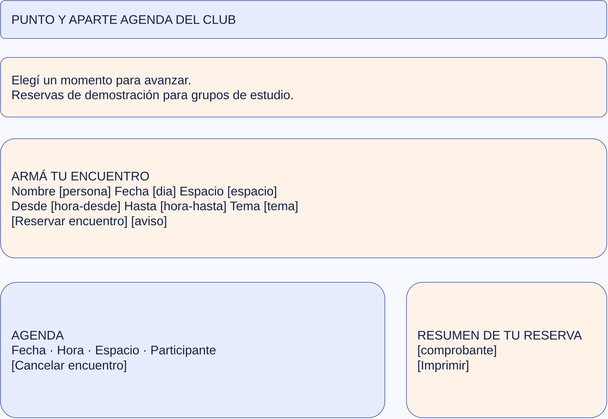
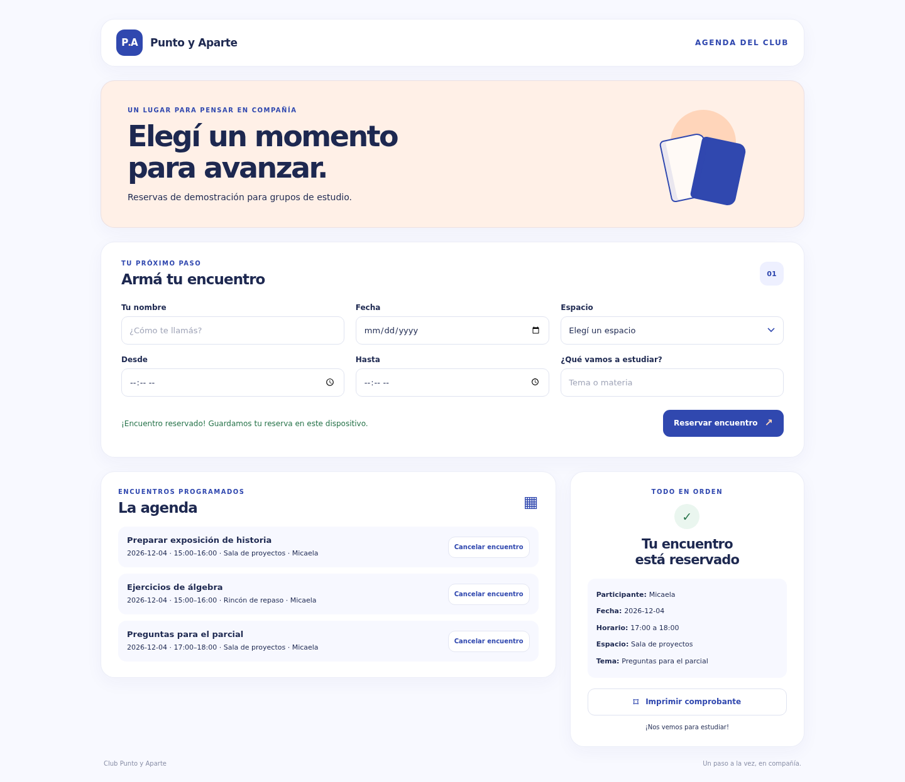
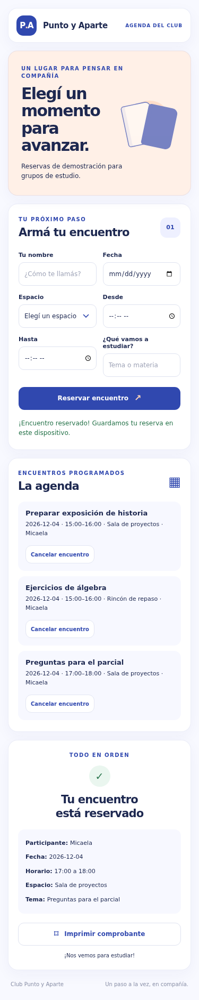

# Encuentros de estudio

## 🧩 Datos generales

| Campo | Detalle |
| --- | --- |
| Integrante 1 | Micaela Joaquin |
| Integrante 2 | No corresponde: trabajo individual |
| Modelos de IA utilizados | ChatGPT; GPT-6 Luna (asistencia de implementación y revisión) |
| Tecnologías del proyecto | HTML5, CSS3, JavaScript, Markdown y GitHub |
| Link del repositorio | https://github.com/2023micaelajoaquin-droid/turnos-club-estudio |

---

## 📄 Sketch

El boceto define la distribución antes de comenzar el código. En pantalla pequeña los bloques se ordenan en una sola columna.

## Planeamiento

Club Punto y Aparte: un espacio para preparar evaluaciones, destrabar dudas y organizar el estudio en compañía. Estilo gráfico con azul cobalto, durazno, fondo claro y títulos sans serif; botones redondeados y bloques de contenido bien separados. Los ejemplos son educativos y no ofrecen un servicio real de reservas.

## Prompts funcionales

### Prompt 1

> Implementá Encuentros de estudio para Club Punto y Aparte. Archivos index.html, style.css, script.js. Boceto: título horizontal, formulario ancho con campos en dos filas, debajo agenda a la izquierda y comprobante a la derecha; apilar en móvil. Diseño gráfico azul cobalto #3048af, durazno #ffd5ba, fondo #f8f9ff, sans serif y bordes redondeados. Campos persona, dia, espacio, hora-desde, hora-hasta, tema; espacios Sala de proyectos y Rincón de repaso. Avisos en aviso, comprobante en comprobante. Guardar reservas en localStorage, ordenar por fecha/hora y permitir cancelar. Detectar intervalos superpuestos para igual día y espacio: nuevoInicio < finExistente y nuevoFin > inicioExistente. Aceptar consecutivos y distintos recursos simultáneos. Rechazar campos vacíos, fechas inválidas y fin no posterior al inicio; permitir fechas pasadas para ejercicios. Solo confirmar y mostrar comprobante si se pudo guardar. Si se rechaza o cancela la reserva del comprobante, ocultarlo. Manejar datos corruptos o almacenamiento no disponible con un aviso. Imprimir solo el comprobante válido, sin la interfaz. Renderizar datos como texto, mantener foco y etiquetas; campos horarios legibles de al menos 100 px desde 320 px, sin frameworks.

### Prompt 2

> Usá IDs descriptivos en lugar de los números internos del boceto: inicio, bienvenida, formulario-reserva, agenda y comprobante. Actualizá las referencias en JavaScript y los estilos de impresión para que el enlace de inicio funcione y se imprima únicamente el comprobante visible.

Se corrigieron los identificadores del HTML y sus referencias. Los números del diagrama no eran nombres de controles; además, los selectores CSS con un número sin escapar no se interpretaban correctamente.

### Ajuste visual

> Alineá P, el punto y A en una sola fila dentro de la marca; el contenedor en grid los apilaba y recortaba las letras.

La marca usa ahora una fila flex centrada.

## Uso y decisiones

La agenda organiza encuentros del club en dos espacios: Sala de proyectos y Rincón de repaso. Cada reserva pide participante, día, espacio, inicio, fin y tema. Para crear un encuentro, completá esos datos y presioná Reservar encuentro. El comprobante aparece solo después de guardar la reserva.

Dos reservas se cruzan si pertenecen al mismo día y espacio y sus intervalos se superponen. Un encuentro puede comenzar justo cuando termina el anterior. La agenda se ordena por fecha y hora; Cancelar encuentro elimina la reserva guardada.

Los datos quedan en este navegador. Es una demostración local para practicar: las reservas no se comparten entre dispositivos ni bloquean un espacio real.

## Comprobaciones

Se probaron reservas válidas, cruces parciales, horarios consecutivos, dos espacios a la misma hora, recarga, cancelación e impresión. Un fin anterior al inicio se rechaza. La interfaz no desborda a 320, 375, 768 y 1280 px y los campos horarios conservan un ancho legible.

Las siete pruebas de lógica se ejecutan con `node test/logic.test.js`. Cubren validaciones, superposiciones, orden y errores de almacenamiento.

[Ejemplo de comprobante impreso](evidencias/comprobante.pdf)

## Estado

- [x] Sketch previo al código.
- [x] Prompts y correcciones registrados.
- [x] Funcionamiento probado en navegador.
- [x] Código guardado en el repositorio público de GitHub.

## Enlaces

[Repositorio](https://github.com/2023micaelajoaquin-droid/turnos-club-estudio)

[Aplicación](https://2023micaelajoaquin-droid.github.io/turnos-club-estudio/)
